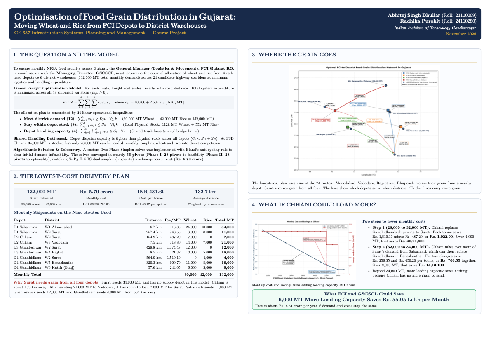

# Gujarat food-grain distribution: illustrative optimization study

CE 637 Infrastructure Systems: Planning and Management, IIT Gandhinagar. Authors: Abhitej Singh Bhullar (23110009) and Radhika Purohit (24110280).

The model selects four supply nodes and six district demand proxy points for wheat and rice. It minimizes monthly freight and handling cost with commodity stocks, district requirements and shared depot dispatch limits: 48 shipment variables and 24 inequalities. This is an illustrative scenario, not a verified Gujarat operating plan.

## Project poster

*Click the poster image above or [open report/Poster.pdf](report/Poster.pdf) to view or download the full-resolution A3 landscape PDF deliverable.*

## Data status

Coordinates, stocks, dispatch caps, district requirements and the ₹100/MT handling and ₹2.50/MT-km haulage coefficients are **ASSUMPTION**. Historical government records support selected facility names only. The stored OSRM response is **RETRIEVED** evidence, with no independently verified original acquisition timestamp; rounded distances, durations and costs are **CALCULATED**. OSRM uses fastest driving routes, not certified truck paths. Field-level categories, verification status and sources are in `data/source_register.csv`. Read `outputs/audit/data_provenance_audit.md` for evidence and access limitations.

## Reproduce

Use the existing `.venv` or create a Python environment and install `requirements.txt` plus `pypdf` for PDF checks. LaTeX (`pdflatex`) is required to compile the deliverables. Run `.venv/bin/python scripts/reproduce.py`; it replays the stored response without changing raw evidence. No live network query is needed to reproduce baseline results. An explicit refresh preserves a separate snapshot and does not replace baseline evidence.

## Verified results

- Cost: ₹56,982,720/month, serving assumed demand of 132,000 MT, with 17,513,100 tonne-km.
- Custom two-phase simplex: 28 Phase I plus 28 Phase II pivots, matching SciPy HiGHS objective. The exported allocation is the selected HiGHS optimum; other commodity splits can attain the same cost.
- Chhani marginal savings: ₹1,022.90/MT below 32,000 MT, ₹706.55/MT between 32,000 and 34,000 MT, zero above 34,000 MT. One-sided values differ at breakpoints.
- Increasing assumed Chhani capacity from 28,000 to 34,000 MT saves ₹5,504,700/month. Construction cost, attainable throughput and investment payback remain unverified.
- Sampled freight coefficients preserve aggregate route flows. Two-decimal route-cost rounding causes small departures from the unrounded affine budget formula.

## Deliverables and evidence

[`report/Final_Report.pdf`](report/Final_Report.pdf): seven A4 pages, one technical section per page plus references. [`report/Poster.pdf`](report/Poster.pdf): one A3 landscape page (previewed above). Markdown/LaTeX sources are in `report/`; computational tables and figures are in `outputs/`. Audit findings and full verification logs are in `outputs/audit/`.

The independent audit found that the earlier passing tests overlooked false provenance labels, a wrong breakpoint, a one-row flow discrepancy, unsupported payback claims and solver edge-case failures. The corrected checks execute the solver, compare feasibility and objectives with HiGHS, exercise infeasible and degenerate cases, test immutable replay and check final PDF content.

## Live routing cross-check completed

A fresh HTTPS OSRM Table request succeeded during this audit. The separate response `data/raw/osrm_response_20261106T202929537569Z_bc5ce0f7c3f3.json` has a timestamp/hash/query manifest; all 24 distance and duration values exactly match the preserved baseline. See `outputs/audit/live_routing_comparison.txt` and `live_routing_check.log`. The original baseline hash remains unchanged. This verifies the routing output today, while the original acquisition timestamp and real facility identities remain unverified.
