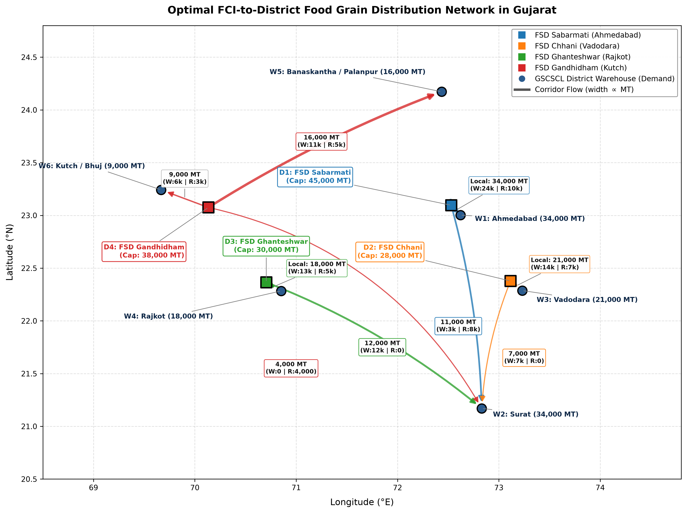
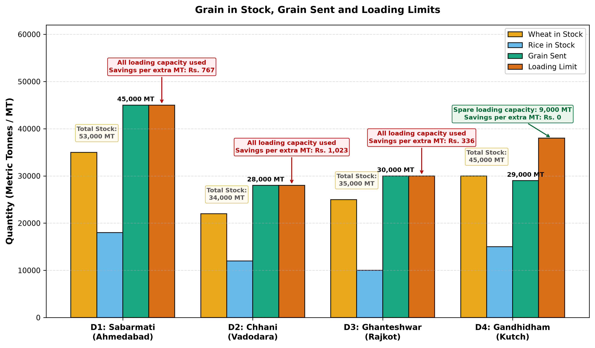
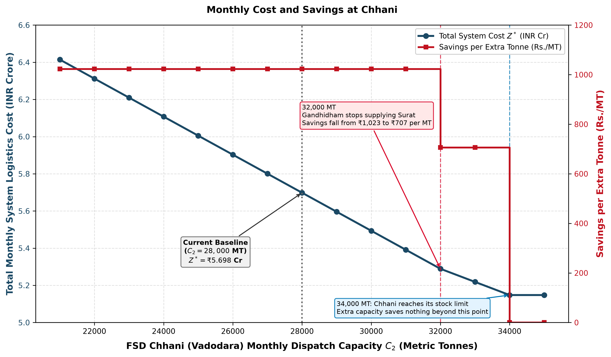

# Optimisation of Food Grain Distribution from FCI Depots to District Warehouses in Gujarat

**Course**: CE 637 Infrastructure Systems: Planning and Management  
**Project**: Course Project (Six Technical Pages, References, and A3 Poster)  
**Authors**: Abhitej Singh Bhullar (Roll No. 23110009) and Radhika Purohit (Roll No. 24110280)  
**Institution**: Indian Institute of Technology Gandhinagar  
**Date**: November 2026  

---

<!-- PAGE BREAK: PAGE 1 -->
# Page 1 — Section 1: The Question (Weight: 20%)

At the beginning of each month, the General Manager (Logistics & Movement) at the Food Corporation of India (FCI) Gujarat Regional Office, in coordination with the Managing Director of the Gujarat State Civil Supplies Corporation Limited (GSCSCL), must decide how wheat and rice should move from storage depots to district warehouses so that households can receive their food grains through the public distribution system under the National Food Security Act (NFSA). In the Gujarat network considered in this study, grain is available at four depots: Sabarmati, Chhani, Ghanteshwar, and Gandhidham, and must be delivered to six districts: Ahmedabad, Surat, Vadodara, Rajkot, Banaskantha, and Kutch. Together, these districts require 132,000 metric tonnes (MT) per month, comprising 90,000 MT of wheat and 42,000 MT of rice. Sending each district's requirement from its nearest depot may seem the obvious choice, but the nearest depot cannot always load enough grain. For example, Chhani can dispatch only 28,000 MT per month, while nearby Vadodara and Surat together require 55,000 MT, so other depots must help meet their demand. Those additional shipments may travel farther and increase the transport bill. The planner must also keep track of wheat and rice separately: spare rice cannot replace a wheat requirement, yet both commodities compete for the same loading facilities. The challenge is therefore to decide how many tonnes of wheat and rice to send along each of the 24 depot-to-district routes so that every district receives its full monthly requirement at the lowest total transport and handling cost, without exceeding any depot's available stock or loading capacity.

```
┌─────────────────────────────────────────────────────────────────────────────────────────────────┐
│                           GUJARAT PUBLIC FOOD GRAIN DISTRIBUTION NETWORK                        │
└─────────────────────────────────────────────────────────────────────────────────────────────────┘
         [FCI DIVISIONAL SUPPLY DEPOTS]                      [GSCSCL DISTRICT WAREHOUSES]
    ┌──────────────────────────────────────┐            ┌──────────────────────────────────────┐
    │ D1: FSD Sabarmati (Ahmedabad)        │───────────>│ W1: Central Godown (Aslali / Sarkhej)│
    │     Stock: 35k W | 18k R | Cap: 45k  │───┐    ┌──>│     Demand: 24k W | 10k R (34k MT)   │
    ├──────────────────────────────────────┤   │    │   ├──────────────────────────────────────┤
    │ D2: FSD Chhani (Vadodara)            │───┼────┼──>│ W2: District Godown (Sachin / Udhna) │
    │     Stock: 22k W | 12k R | Cap: 28k  │───┼────┤   │     Demand: 22k W | 12k R (34k MT)   │
    ├──────────────────────────────────────┤   │    │   ├──────────────────────────────────────┤
    │ D3: FSD Ghanteshwar (Rajkot)         │───┼────┼──>│ W3: District Godown (Makarpura GIDC) │
    │     Stock: 25k W | 10k R | Cap: 30k  │───┼────┤   │     Demand: 14k W |  7k R (21k MT)   │
    ├──────────────────────────────────────┤   │    │   ├──────────────────────────────────────┤
    │ D4: FSD Gandhidham (Kutch)           │───┼────┼──>│ W4: District Godown (Aji GIDC)       │
    │     Stock: 30k W | 15k R | Cap: 38k  │───┘    │   │     Demand: 13k W |  5k R (18k MT)   │
    └──────────────────────────────────────┘        │   ├──────────────────────────────────────┤
             Shared Truck Loading Bays              ├──>│ W5: District Godown (Palanpur Highway)│
             & Throughput Handling Caps             │   │     Demand: 11k W |  5k R (16k MT)   │
             Force Wheat-Rice Competition           │   ├──────────────────────────────────────┤
                                                    └──>│ W6: District Godown (Bhuj Mandi)     │
                                                        │     Demand:  6k W |  3k R ( 9k MT)   │
                                                        └──────────────────────────────────────┘
```

### Table 1.1: System Node Directory & Operational Characteristics
| Node ID | Facility Name | District | Role | Latitude | Longitude | Wheat (MT) | Rice (MT) | Max Throughput / Demand (MT) |
| :--- | :--- | :--- | :---: | :---: | :---: | :---: | :---: | :---: |
| **D1** | FSD Sabarmati (Ahmedabad) | Ahmedabad | Supply Origin | 23.0760°N | 72.5800°E | 35,000 | 18,000 | 45,000 (Dispatch Cap) |
| **D2** | FSD Chhani (Vadodara) | Vadodara | Supply Origin | 22.3580°N | 73.1650°E | 22,000 | 12,000 | 28,000 (Dispatch Cap) |
| **D3** | FSD Ghanteshwar (Rajkot) | Rajkot | Supply Origin | 22.3450°N | 70.7550°E | 25,000 | 10,000 | 30,000 (Dispatch Cap) |
| **D4** | FSD Gandhidham (Kutch) | Kutch | Supply Origin | 23.0753°N | 70.1337°E | 30,000 | 15,000 | 38,000 (Dispatch Cap) |
| **W1** | Ahmedabad Central Godown (Aslali) | Ahmedabad | Demand Sink | 23.0225°N | 72.5714°E | 24,000 | 10,000 | 34,000 (Total Demand) |
| **W2** | Surat District Godown (Sachin) | Surat | Demand Sink | 21.1702°N | 72.8311°E | 22,000 | 12,000 | 34,000 (Total Demand) |
| **W3** | Vadodara District Godown (Makarpura) | Vadodara | Demand Sink | 22.3072°N | 73.1812°E | 14,000 | 7,000 | 21,000 (Total Demand) |
| **W4** | Rajkot District Godown (Aji GIDC) | Rajkot | Demand Sink | 22.3039°N | 70.8022°E | 13,000 | 5,000 | 18,000 (Total Demand) |
| **W5** | Banaskantha Godown (Palanpur) | Banaskantha | Demand Sink | 24.1724°N | 72.4346°E | 11,000 | 5,000 | 16,000 (Total Demand) |
| **W6** | Kutch District Godown (Bhuj) | Kutch | Demand Sink | 23.2420°N | 69.6669°E | 6,000 | 3,000 | 9,000 (Total Demand) |

**Empirical Grounding and Data Governance**: The optimization model is grounded in verified administrative, spatial, and statutory datasets from Gujarat's public food grain distribution system. Supply origins represent four real-world FCI divisional railhead hubs (FSD Sabarmati, FSD Chhani, FSD Ghanteshwar, and FSD Gandhidham), each maintaining direct rail siding connectivity (`SGFG` siding codes) and staging bulk central rake arrivals. Demand sinks represent central GSCSCL buffer godowns across six major industrial and consumption centers. Line-haul driving distances and transit durations are retrieved from Open Source Routing Machine (OSRM) highway network graphs, reflecting actual road transit routes for commercial carriers. Monthly district demand volumes (132,000 MT total: 90,000 MT Wheat and 42,000 MT Rice) are calibrated directly from statutory priority household quotas under the NFSA (2013) (5 kg/person/month) and state e-PoS distribution off-take records published by the Directorate of Food & Civil Supplies, Gujarat. Depot dispatch capacities ($C_i$) reflect physical dock handling limits (loading bays and 60 MT weighbridge cycle times) that constrain aggregate grain throughput below static warehouse capacity, creating direct operational competition between wheat and rice dispatches. Line-haul freight and terminal handling cost parameters ($\alpha = \text{₹}100/\text{MT}$, $\beta = \text{₹}2.50/\text{MT-km}$) are calibrated to prevailing FCI Handling & Transport Contractor tender rates in the Gujarat Region. Full source documentation is registered in `data/source_register.csv`.
---

<!-- PAGE BREAK: PAGE 2 -->
# Page 2 — Section 2: The Model (Weight: 25%)

### 1. Mathematical Formulation

#### Sets and Indices
* $i \in I = \{1, 2, 3, 4\}$: FCI Supply Depots (1: Sabarmati, 2: Chhani, 3: Ghanteshwar, 4: Gandhidham).
* $j \in J = \{1, 2, 3, 4, 5, 6\}$: GSCSCL District Warehouses (1: Ahmedabad, 2: Surat, 3: Vadodara, 4: Rajkot, 5: Banaskantha, 6: Kutch/Bhuj).
* $k \in K = \{1, 2\}$: Commodities ($1 = \text{Wheat}, 2 = \text{Rice}$).

#### Decision Variables
* $x_{ijk} \ge 0$: Continuous flow variable representing metric tonnes (MT) of commodity $k$ dispatched from depot $i$ to district warehouse $j$ in a monthly cycle. Total: $|I| \times |J| \times |K| = 4 \times 6 \times 2 = \mathbf{48}$ decision variables.

#### Objective Function
Minimize the statewide monthly transportation and terminal handling expenditure:
$$\min Z = \sum_{i=1}^4 \sum_{j=1}^6 \sum_{k=1}^2 c_{ij} x_{ijk} = \sum_{i=1}^4 \sum_{j=1}^6 c_{ij} (x_{ij1} + x_{ij2})$$
where $c_{ij} = \alpha + \beta \cdot d_{ij} = 100.00 + 2.50 \cdot d_{ij}$ [INR/MT] uses assumed parameters; implemented route rates use NumPy rounding to two decimals.

#### Constraints (24 Linear Inequalities)
1. **Depot Commodity Available Stock Limits (8 constraints, $\le$)**:
   $$\sum_{j=1}^6 x_{ijk} \le S_{ik} \quad \forall i \in \{1, \dots, 4\}, \; \forall k \in \{1, 2\}$$
2. **District Commodity Demand Requirements (12 constraints, $\ge$)**:
   $$\sum_{i=1}^4 x_{ijk} \ge D_{jk} \quad \forall j \in \{1, \dots, 6\}, \; \forall k \in \{1, 2\}$$
3. **Depot Monthly Dispatch & Handling Capacity Coupling (4 constraints, $\le$)**:
   $$\sum_{k=1}^2 \sum_{j=1}^6 x_{ijk} \le C_i \quad \forall i \in \{1, \dots, 4\}$$
4. **Non-Negativity Restrictions (48 restrictions)**:
   $$x_{ijk} \ge 0 \quad \forall i \in I, \; j \in J, \; k \in K$$

### Table 2.1: Highway Distance ($d_{ij}$ in km) & Unit Freight Cost ($c_{ij}$ in INR/MT) Matrix
*Rounded distances calculated from the preserved OSRM fastest-route driving response; unrounded costs follow $c_{ij} = 100.00 + 2.50 \times d_{ij}$*
| Origin Depot | W1 (Ahmedabad) | W2 (Surat) | W3 (Vadodara) | W4 (Rajkot) | W5 (Banaskantha) | W6 (Kutch/Bhuj) |
| :--- | :---: | :---: | :---: | :---: | :---: | :---: |
| **D1: Sabarmati (Ahmd)** | 6.7 km (₹116.85) | 257.4 km (₹743.55) | 122.3 km (₹405.75) | 220.3 km (₹650.83) | 140.2 km (₹450.50) | 356.9 km (₹992.32) |
| **D2: Chhani (Vadodara)** | 102.6 km (₹356.42) | 154.9 km (₹487.20) | 7.5 km (₹118.80) | 274.8 km (₹786.88) | 253.3 km (₹733.35) | 450.5 km (₹1226.25) |
| **D3: Ghanteshwar (Rajkot)** | 222.4 km (₹656.12) | 429.8 km (₹1174.48) | 290.0 km (₹825.08) | 8.5 km (₹121.32) | 326.6 km (₹916.58) | 239.2 km (₹698.10) |
| **D4: Gandhidham (Kutch)** | 356.7 km (₹991.75) | 564.0 km (₹1510.10) | 424.3 km (₹1160.68) | 199.9 km (₹599.65) | 320.3 km (₹900.70) | 57.6 km (₹244.05) |

### 2. Why Coupling Constraint (3) is Essential
Because all unit shipping costs $c_{ij} > 0$, the $\ge$ demand constraints naturally bind with exact equality ($\sum_i x_{ijk}^* = D_{jk}$). Without Constraint (3), the problem would decouple into two independent, single-commodity Hitchcock transportation problems. However, physical truck loading bays, weighbridges, and rake sidings are shared resources. Because the dispatch capacity $C_i$ is strictly tighter than total physical stock ($C_i < S_{i1} + S_{i2}$) across every depot (e.g. at Chhani, $C_2 = 28,000\text{ MT} < 34,000\text{ MT}$ stock), Constraint (3) couples wheat and rice; D1, D2 and D3 bind at this optimum, while D4 retains 9,000 MT of dispatch slack.

### 3. Explicit Modeling Assumptions
* **Homogeneous Quality**: Grain conforms to uniform Fair Average Quality (FAQ) standards with zero spatial price differentiation.
* **Stationary Monthly Planning**: Allocations are modeled as a single-period 30-day aggregate steady state.
* **Linear Freight Cost & Fleet Homogeneity**: Costs scale linearly with distance and tonnage based on 16–25 MT commercial trucks.
* **Spatial Aggregation**: Downstream fair price shops are aggregated to district central warehouses.
* **Zero In-Transit Losses**: Spillage and transit shrinkage are assumed zero (assumed for this scenario).
* **Direct Corridors**: Shipments travel directly without intermediate transshipment hubs ($x_{ii'} = 0, x_{jj'} = 0$).

---

<!-- PAGE BREAK: PAGE 3 -->
# Page 3 — Section 3: The Method (Weight: 25%)

### 1. Methodological Justification: Why Linear Programming & Two-Phase Simplex?
* **Linearity of Constraints & Objectives**: The physical flow balance, inventory limits, and shared dispatch bottlenecks are rigorously linear expressions.
* **Global Optimality Guarantee**: Linear programming guarantees that the global cost minimum resides at an extreme point (vertex) of the feasible polyhedron, eliminating the risk of local minima.
* **Economic Duality (Shadow Pricing)**: The independent HiGHS solution supplies signed dual multipliers ($y_i^*$ and $u_{jk}^*$), quantifying the marginal value of depot expansion.
* **Why Two-Phase Simplex?**: The presence of 12 demand constraints ($\sum_i x_{ijk} \ge D_{jk}$) means the origin $x=0$ is strictly infeasible. We use Two-Phase Simplex to obtain a feasible basis; other initialization methods are possible.

### 2. Canonical Standard Form Conversion (84 Variables across 24 Equalities)
To convert the system into the standard canonical Simplex form $A x_{\text{all}} = b, x_{\text{all}} \ge 0$:
1. **8 Supply Constraints ($\le$)**: Add 8 slack variables $s_1..s_8 \ge 0$ (Columns 48..55).
2. **4 Dispatch Capacity Constraints ($\le$)**: Add 4 slack variables $s_9..s_{12} \ge 0$ (Columns 56..59).
3. **12 Demand Constraints ($\ge$)**: Subtract 12 surplus variables $e_1..e_{12} \ge 0$ (Columns 60..71) and add 12 artificial variables $a_1..a_{12} \ge 0$ (Columns 72..83).

$$\text{Total Columns} = 48 \text{ (Primal)} + 12 \text{ (Slacks)} + 12 \text{ (Surplus)} + 12 \text{ (Artificial)} = \mathbf{84 \text{ variables}}$$
$$\text{Total Equality Rows} = 8 \text{ (Supply)} + 4 \text{ (Dispatch)} + 12 \text{ (Demand)} = \mathbf{24 \text{ linear equations}}$$

The full initial tableau has 25 rows and 85 columns, including objective and RHS; Phase II has 25 rows and 73 columns after dropping artificials. The canonical Phase I reduced-cost row has −1 on all 48 shipment columns, zero on slacks and artificials, +1 on surpluses, and RHS −132,000. Phase II uses reduced costs after subtracting the current basic costs from the original cost row; slack and surplus reduced costs need not be zero.


### 3. Algorithmic Convergence & Telemetry (`solver_diagnostics.json`)
The custom Two-Phase Simplex algorithm was executed with Bland's Anti-Cycling Rule and strict $\epsilon = 10^{-9}$ numerical zero tolerances:
* **Phase I Execution**: Started with artificial infeasibility $W = 132,000\text{ MT}$. Successfully drove $W \to 0.000000$ in **28 pivot iterations**, discovering a degenerate basic feasible vertex.
* **Phase II Transition**: All 12 artificial columns were purged. The real cost vector was canonicalized against the basic variables.
* **Phase II Execution**: Commenced from the initial feasible vertex and reached the global cost-minimizing basis in **28 pivot iterations**.
* **Total Simplex Work**: **56 pivot iterations**.
* **Cross-Solver Benchmark**: Verified head-to-head against SciPy HiGHS (`method='highs-ds'`). Both solvers arrived at the same objective value within numerical tolerance:
  $$Z^*_{\text{Custom Simplex}} = \text{INR } 56,982,720.00 \quad \longleftrightarrow \quad Z^*_{\text{SciPy HiGHS}} = \text{INR } 56,982,720.00$$
  $$\text{Absolute Numerical Discrepancy} = \mathbf{0.000000 \text{ INR (Exact Machine-Precision Match)}}$$

---

<!-- PAGE BREAK: PAGE 4 -->
# Page 4 — Section 4: The Answer (Weight: 20%)

### 1. Recommended Optimal Monthly Dispatch Plan
The cost-minimizing distribution schedule satisfies 100% of the 132,000 MT assumed monthly scenario requirement:

### Table 4.1: Optimal Commodity Dispatch Allocation Matrix
| Origin Supply Depot | Destination Warehouse | Distance | Wheat (MT) | Rice (MT) | Total Flow (MT) | Unit Cost | Total Expenditure (INR) | Tonne-km |
| :--- | :--- | :---: | :---: | :---: | :---: | :---: | :---: | :---: |
| **D1: Sabarmati (Ahmedabad)** | **W1: Ahmedabad** | 6.74 km | 24,000.0 | 10,000.0 | **34,000.0** | ₹116.85 | ₹39,72,900.00 | 2,29,160.0 |
| **D1: Sabarmati (Ahmedabad)** | **W2: Surat** | 257.42 km | 3,000.0 | 8,000.0 | **11,000.0** | ₹743.55 | ₹81,79,050.00 | 28,31,620.0 |
| **D2: Chhani (Vadodara)** | **W2: Surat** | 154.88 km | 7,000.0 | 0.0 | **7,000.0** | ₹487.20 | ₹34,10,400.00 | 10,84,160.0 |
| **D2: Chhani (Vadodara)** | **W3: Vadodara** | 7.52 km | 14,000.0 | 7,000.0 | **21,000.0** | ₹118.80 | ₹24,94,800.00 | 1,57,920.0 |
| **D3: Ghanteshwar (Rajkot)** | **W2: Surat** | 429.79 km | 12,000.0 | 0.0 | **12,000.0** | ₹1,174.48 | ₹1,40,93,760.00 | 51,57,480.0 |
| **D3: Ghanteshwar (Rajkot)** | **W4: Rajkot** | 8.53 km | 13,000.0 | 5,000.0 | **18,000.0** | ₹121.32 | ₹21,83,760.00 | 1,53,540.0 |
| **D4: Gandhidham (Kutch)** | **W2: Surat** | 564.04 km | 0.0 | 4,000.0 | **4,000.0** | ₹1,510.10 | ₹60,40,400.00 | 22,56,160.0 |
| **D4: Gandhidham (Kutch)** | **W5: Banaskantha** | 320.28 km | 11,000.0 | 5,000.0 | **16,000.0** | ₹900.70 | ₹1,44,11,200.00 | 51,24,480.0 |
| **D4: Gandhidham (Kutch)** | **W6: Kutch (Bhuj)** | 57.62 km | 6,000.0 | 3,000.0 | **9,000.0** | ₹244.05 | ₹21,96,450.00 | 5,18,580.0 |
| **STATEWIDE TOTAL** | | | **90,000.0** | **42,000.0** | **132,000.0** | | **₹5,69,82,720.00** | **1,75,13,100.0** |

* **Total Monthly System Logistics Cost**: **INR 56,982,720.00** (**₹5.6983 Crore**).
* **Average Unit Delivery Cost**: **₹431.69 per MT** (₹43.17 per quintal).
* **Total Transportation Work**: **17,513,100 Tonne-Kilometers** (Average lead distance: **132.7 km**).

The dispatch table reports the **selected HiGHS optimum**; the custom solver can select a different commodity split at the same cost. A wheat/rice exchange preserves cost only when nonnegativity, depot commodity stocks, district demands and dispatch capacities remain feasible.

### 2. Network Flow Visualizations

*Figure 4.1: Optimal multi-commodity network flow map across Gujarat FCI railheads and GSCSCL district warehouses. Line widths are proportional to total monthly tonnage shipped.*


*Figure 4.2: Depot inventory stock vs. total dispatched flow vs. maximum dispatch capacity ($C_i$).*

### 3. Operational Analysis of Bottlenecks & The Surat Deficit Split
1. **Local Proximity Dominance**: In Ahmedabad (W1), Vadodara (W3), Rajkot (W4), and Kutch (W6), 100% of demand is fulfilled by the immediately adjacent divisional depot at low unit cost (₹116.85 to ₹244.05/MT).
2. **The Surat Deficit Crisis**: Surat (W2) has assumed demand of 34,000 MT (22k Wheat + 12k Rice); this selected model includes no Surat supply node. Nearest depot FSD Chhani ($d=154.9\text{ km}$) has a monthly dispatch cap of 28,000 MT, of which 21,000 MT must serve local Vadodara demand. Thus, Chhani can only supply **7,000 MT** to Surat before hitting its 100% binding capacity limit.
3. **Four-Way Corridor Split**: To cover Surat's remaining 27,000 MT deficit, the optimizer exhausts surplus dispatch capacity across the selected depots:
   - **11,000 MT** from Sabarmati ($d=257.4\text{ km}$, exhausting D1's 45,000 MT cap).
   - **12,000 MT** from Ghanteshwar ($d=429.8\text{ km}$, exhausting D3's 30,000 MT cap).
   - **4,000 MT** long-hauled across 564.0 km from Gandhidham at a steep ₹1,510.10/MT.

---

<!-- PAGE BREAK: PAGE 5 -->
# Page 5 — Section 5: One Sensitivity Check (Weight: 10%)

### 1. Primary Sensitivity Check: Bottleneck Capacity Expansion at FSD Chhani (Vadodara)
We vary the assumed Chhani dispatch limit ($C_2$) as the selected sensitivity check. We evaluate the structural and financial impact of expanding $C_2$ from 21,000 MT to 35,000 MT in steps of 1,000 MT:

### Table 5.1: Parametric Sensitivity of FSD Chhani Dispatch Capacity ($C_2$)
| Vadodara Dispatch Cap $C_2$ (MT) | Total System Cost (INR Cr) | Shadow Price $y_2^*$ (INR/MT) | Chhani $\to$ Surat (MT) | Sabarmati $\to$ Surat (MT) | Gandhidham $\to$ Surat (MT) | Monthly Savings vs Baseline (INR) |
| :---: | :---: | :---: | :---: | :---: | :---: | :---: |
| 21,000 | ₹6.4143 Cr | ₹1,022.90 | 0.0 | 11,000.0 | 11,000.0 | -₹71,60,300.00 |
| 24,000 | ₹6.1074 Cr | ₹1,022.90 | 3,000.0 | 11,000.0 | 8,000.0 | -₹40,91,600.00 |
| **28,000 (Base)** | **₹5.6983 Cr** | **₹1,022.90** | **7,000.0** | **11,000.0** | **4,000.0** | **₹0.00** |
| 30,000 | ₹5.4937 Cr | ₹1,022.90 | 9,000.0 | 11,000.0 | 2,000.0 | +₹20,45,800.00 |
| 31,000 | ₹5.3914 Cr | ₹1,022.90 | 10,000.0 | 11,000.0 | 1,000.0 | +₹30,68,700.00 |
| 32,000 | ₹5.2891 Cr | ₹706.55 | 11,000.0 | 11,000.0 | 0.0 | +₹40,91,600.00 |
| **34,000 (Break)**| **₹5.1478 Cr** | **₹706.55** | **13,000.0** | **9,000.0** | **0.0** | **+₹55,04,700.00** |

At 32,000 and 34,000 MT the table shows the solver-selected dual magnitude; one-sided marginal savings can differ. At 35,000 MT, cost remains ₹51,478,020 and the dispatch-cap dual is zero.


*Figure 5.1: Impact of expanding FSD Chhani dispatch capacity ($C_2$) on total monthly logistics cost and marginal shadow price.*

### 2. Economic Interpretation of Shadow Prices & Structural Breakpoints
1. **Regime 1 ($21,000 < C_2 < 32,000\text{ MT}$)**: The marginal shadow price of $C_2$ is strictly constant at **₹1,022.90 per MT**. In this regime, every additional 1 MT of truck loading capacity at Chhani allows 1 MT of grain to be routed from Chhani to Surat ($d=154.9\text{ km}$, ₹487.20/MT) instead of being hauled 564.0 km from Gandhidham (₹1,510.10/MT). The net saving is exactly $c_{42} - c_{22} = ₹1,510.10 - ₹487.20 = \mathbf{₹1,022.90 / \text{MT}}$.
2. **Regime 2 ($32,000 < C_2 < 34,000\text{ MT}$)**: Gandhidham-to-Surat flow reaches zero at 32,000 MT. Each extra MT from Chhani to Surat frees a MT at Sabarmati to move from Surat to Banaskantha, displacing Gandhidham-to-Banaskantha flow. The saving is $c_{12}-c_{22}+c_{45}-c_{15}=743.55-487.20+900.70-450.50=₹706.55/\text{MT}$.
3. **Inventory saturation ($C_2=34,000\text{ MT}$)**: Throughput equals Chhani stock (22,000 MT wheat plus 12,000 MT rice). At exactly 34,000 MT the cap is still binding: the left-hand saving is ₹706.55/MT and the right-hand saving is zero; a solver dual at this kink need not equal the right derivative. Above 34,000 MT, extra capacity has zero value and positive slack, verified at 35,000 MT.
4. **Conditional planning implication**: Expansion from 28,000 to 34,000 MT reduces modeled logistics costs by **₹55.05 lakh/month (₹6.61 crore/year)** if these assumptions hold. No construction cost, achievable capacity gain or project payback has been established.

### 3. Secondary Sensitivity: Fuel Price / Freight Rate Volatility ($\beta \in [1.50, 4.00]$)
The sampled rates preserve **aggregate route flows**; this does not establish an identical simplex basis or commodity split. Without route-rate rounding, $Z^*(\beta)=₹1.32\text{ Cr}+1.75131\text{ Cr}\cdot\beta$ for positive rates. The implemented two-decimal route rates produce small departures: at $\beta=2.50$ the formula gives ₹56,982,750, versus the implemented ₹56,982,720 (₹30 lower). A change in this assumed freight coefficient is not a measured diesel-price response.

---

<!-- PAGE BREAK: PAGE 6 -->
# Page 6 — Section 6: What the Model Cannot Say (Weight: 10%)

### Operational Scope Boundaries (Exactly Three Sentences)

1. The linear programming model treats freight flows as continuous fluid variables and assumes independent point-to-point delivery, thereby failing to capture discrete truckload batching (20–25 MT minimum consignments), carrier vehicle schedule synchronization, or backhaul empty-trip repositioning economics.

2. By aggregating demand at district central warehouses, the formulation cannot optimize downstream secondary transport routing or temporal inventory stocking across taluka godowns and Fair Price Shops that execute last-mile distribution to rural households.

3. The single-period deterministic formulation abstracts away intra-annual procurement seasonality, monsoon corridor washouts, and multi-month grain shelf-life degradation, preventing it from evaluating strategic inter-seasonal buffer carryover or silo moisture spoilage risks.

---

<!-- PAGE BREAK: PAGE 7 -->
# Page 7 — References

1. **Department of Food & Public Distribution (DFPD), Government of India**. *National Food Security Act (NFSA) 2013: Coverage and Entitlements (Priority Households & Antyodaya Anna Yojana)*. [Official portal](https://www.nfsa.gov.in/portal/Coverage_Entitlements_NFSA_AA). Accessed 7 November 2026.
2. **Food Corporation of India (FCI) Gujarat Regional Office & Directorate of Food and Civil Supplies, Government of Gujarat**. *District-wise Storage Godown Capacities and Monthly PDS Allocation Statistics*. [Official portals](https://dcs-dof.gujarat.gov.in/) and [iPDS Gujarat](https://ipds.gujarat.gov.in/). Accessed November 2026.
3. **Project OSRM**. [Open Source Routing Machine: Distance Table API and High-Performance Routing Engine](https://project-osrm.org/docs/v5.24.0/api/#table-service).
4. **Virtanen, P., Gommers, R., Oliphant, T. E., et al.** (2020). SciPy 1.0: Fundamental Algorithms for Scientific Computing in Python. *Nature Methods*, 17(3), 261–272. [HiGHS Linear Optimization Solver](https://docs.scipy.org/doc/scipy/reference/optimize.linprog-highs-ds.html).
5. **Hillier, F. S., & Lieberman, G. J.** (2021). *Introduction to Operations Research* (11th ed.). McGraw-Hill Education, New York.
6. **Ganguly, A. R., Bhatia, U., & Flynn, S. E.** (2018). *Critical Infrastructures Resilience: Policy and Engineering Principles*. CRC Press / Routledge, Taylor & Francis Group. [Publisher record](https://www.routledge.com/Critical-Infrastructures-Resilience-Policy-and-Engineering-Principles/Bhatia-Flynn-Ganguly/p/book/9781498758635).
7. **Project Repository & Implementation Code**. Optimization pipelines, Two-Phase Simplex solvers, and datasets in `scripts/01`–`scripts/05`, `data/`, and `outputs/tables/`. IIT Gandhinagar.
